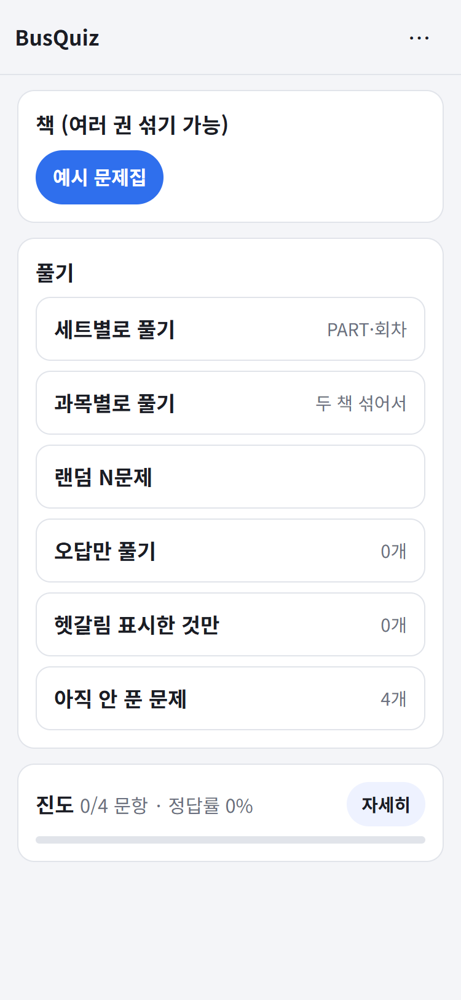
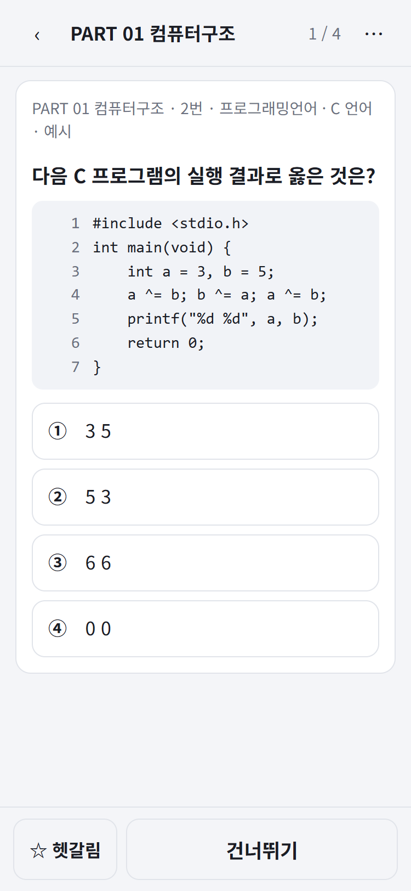
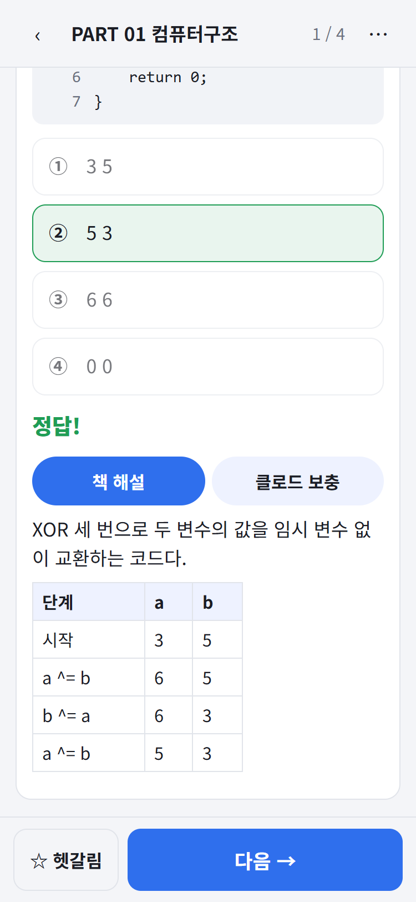
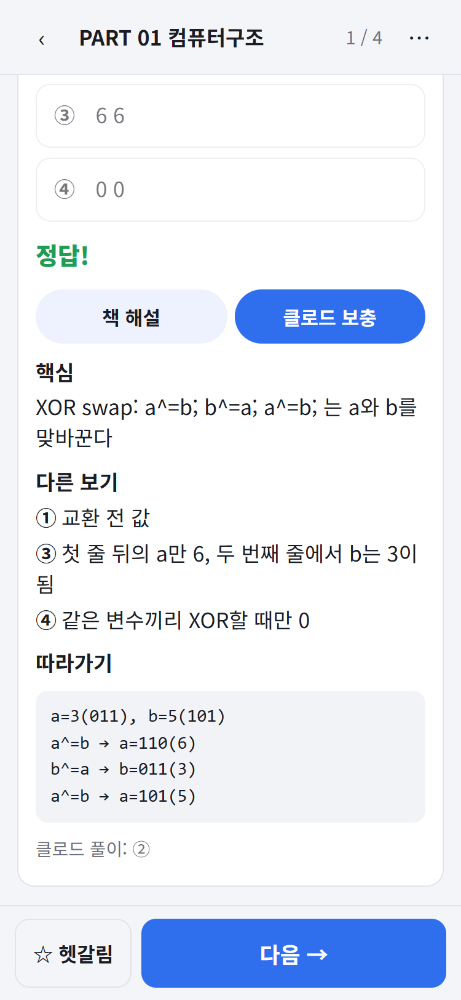
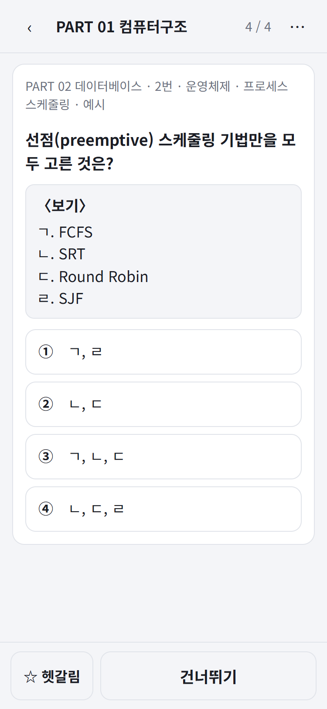
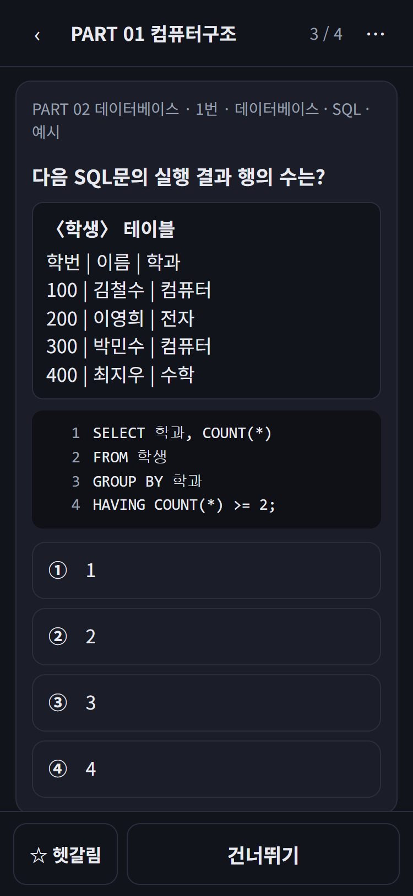
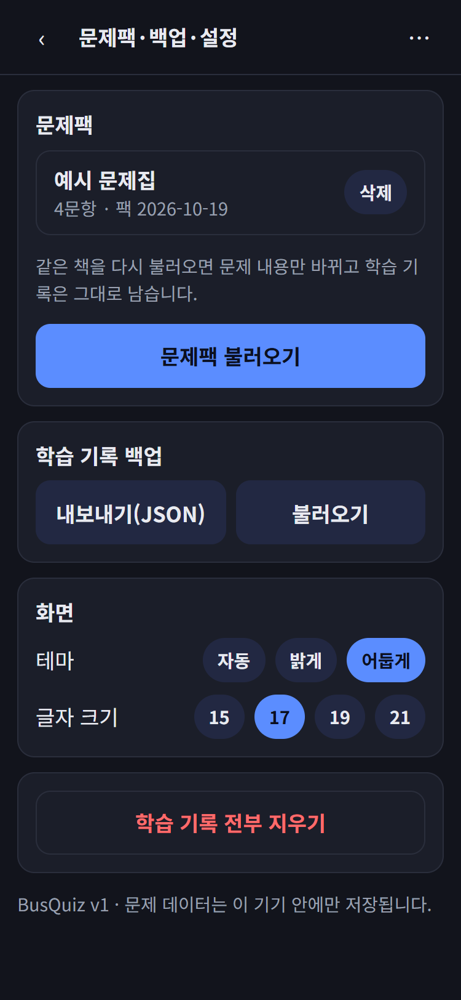
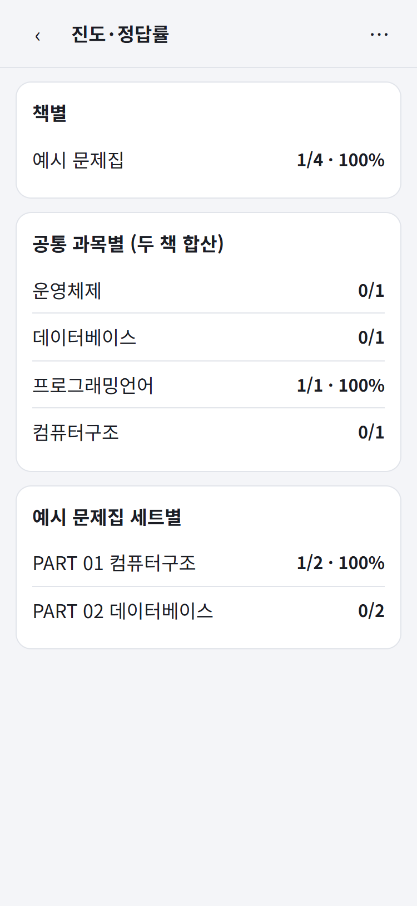
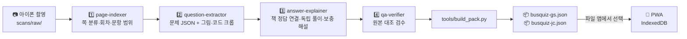

<div align="center">

# 🚌 BusQuiz

### 버스에서 한 손으로 푸는 전산직 기출문제 PWA

공기업 전산직 전공 문제집과 정보처리기사 필기 기출을 **스캔 사진 → 문제 데이터**로 바꾸고,
아이폰에서 **오프라인**으로 풀고 오답을 복습하는 개인용 앱입니다.

<br/>

[](https://zizonpubao.github.io/busquiz/)

<br/>


</div>

---

## 📖 소개

출퇴근 버스에서 두꺼운 수험서를 펼치기는 어렵습니다. 그렇다고 기출문제 앱을 찾아보면
내가 보는 **그 책**의 문제·해설이 들어 있지는 않습니다.

**BusQuiz는 내 책을 그대로 폰에 넣습니다.**

> 책을 폰으로 촬영 → Claude Code 에이전트가 문제·보기·정답·해설을 JSON으로 옮김
> → 문제팩 파일 하나로 묶음 → 아이폰 PWA에서 불러와 오프라인으로 풀기

문제 **2,959문항**(전공 문제집 1,459 + 정처기 15회분 1,500)과 그림·표·코드 크롭 767장이
문제팩 2개(약 19MB)에 들어 있고, 앱은 네트워크 없이 동작합니다.

> ⚠️ **저작권**: 수험서 내용(스캔 원본, 문제 데이터, 문제팩)은 이 저장소에 **없습니다**.
> 저장소에는 앱 코드와 변환 스크립트만 있고, 문제팩은 사용자가 자기 폰에서 직접 불러옵니다.
> 아래 화면의 문제는 README용으로 만든 **예시 문항**입니다.

<div align="center">

### 🔗 **https://zizonpubao.github.io/busquiz/**

</div>

---

## ✨ 주요 기능

| # | 기능 | 요약 |
|---|------|------|
| 1 | 📚 책 섞어 풀기 | 책마다 문제팩을 따로 불러오고, 한 권만 또는 여러 권 섞어서 |
| 2 | 🎯 풀기 모드 | 세트(PART·회차)별 · 공통 과목별 · 랜덤 N문제 · 오답만 · 헷갈림만 · 안 푼 문제 |
| 3 | ✅ 즉시 채점 + 두 가지 해설 | 보기 탭 → 정오 표시 → **책 해설** / **클로드 보충** 탭 분리 |
| 4 | 💻 코드·표·그림 | 줄 번호 붙은 고정폭 코드 블록, 마크다운 표, 원본 크롭 이미지 핀치 줌 |
| 5 | ⏱ 정처기 모의고사 | 회차 100문항 · 150분 타이머(끄기 가능) · 문항표 · 과목별 점수 · 과락/합격 |
| 6 | 🔁 오답 복습 규칙 | 틀리면 오답 목록에, 오답 모드에서 2번 연속 맞히면 빠짐 |
| 7 | 📊 진도·정답률 | 책별 · 공통 과목별 · 세트별 |
| 8 | 💾 백업 | 학습 기록 JSON 내보내기/불러오기, 문제팩을 다시 넣어도 기록 유지 |
| 9 | 🌙 버스용 UX | 한 손 조작, 하단 고정 버튼, 48px 이상 터치 영역, 다크모드, 글자 크기 |

<br/>

### 🎯 1. 홈 — 책 고르고 모드 고르기

<div align="center"></div>

불러온 책이 칩으로 나타나고, 여러 권을 켜면 **공통 과목**(운영체제·데이터베이스·네트워크 …) 기준으로
두 책의 문제가 섞입니다. 풀다 만 세션은 맨 위 **이어풀기**에 뜹니다.

<br/>

### ✅ 2. 풀기 — 보기 탭 → 채점 → 해설

<div align="center">
  
  
  
</div>

- 코드 문제는 **글자 하나까지** 텍스트로 옮기고(들여쓰기·세미콜론·연산자가 답을 바꾸므로) 원본 크롭도 함께 보여줍니다
- **책 해설**과 **클로드 보충**(핵심 개념 · 다른 보기가 틀린 이유 · 변수 추적 · 공기업 전공 확장)은 항상 분리해 저장·표시합니다
- 책 정답과 클로드 풀이가 다르면 책 정답을 기본으로 두고 `답 다름` 배지와 근거를 보여줍니다

<br/>

### 📄 3. 지문·〈보기〉와 다크모드

<div align="center">
  
  
  
</div>

발문과 보기 사이의 상자 지문·〈보기〉(ㄱ·ㄴ·ㄷ)는 별도 상자로, 표는 마크다운 표로 렌더링합니다.
밤 버스를 위해 다크모드는 시스템 설정을 따르거나 직접 고정할 수 있습니다.

<br/>

### 📊 4. 진도·정답률

<div align="center"></div>

---

## 🔄 동작 방식 — 책이 앱에 들어가기까지



- 네 에이전트는 Claude Code 서브에이전트(`.claude/agents/`)로, 10~15쪽씩 **병렬**로 돌립니다
- **책 정답이 기본값**입니다. 클로드가 푼 답이 책과 다르면 덮어쓰지 않고 `answer_conflict` 플래그와 근거만 남깁니다
- 흐리거나 잘린 글자는 지어내지 않고 `[판독불가]`로 두며, 해설 문장·반복 출제 같은 **근거가 있을 때만** 추정 보완하고 앱에 "추정 보완"으로 표시합니다
- 앱 쪽은 문제팩을 IndexedDB에 넣고 서비스워커가 앱 껍데기만 캐시하므로, 한 번 설치하면 **네트워크가 전혀 필요 없습니다**

---

## 🛠 기술 스택

<div align="center">

| 구분 | 기술 |
|------|------|
| **앱** | 순수 HTML / CSS / JavaScript (ES Modules) — 빌드 도구 없음 |
| **오프라인** | Service Worker (stale-while-revalidate), Web App Manifest, IndexedDB, `navigator.storage.persist()` |
| **데이터 변환** | Python 3 (Pillow), Claude Code 서브에이전트 4종 |
| **문제팩** | JSON 1개/책 — 문항 + 세트 목록 + 그림(webp base64) |
| **배포** | GitHub Pages (GitHub Actions, `app/` 폴더만) |

</div>

---

## 📁 프로젝트 구조

```
.
├── app/                    PWA (배포되는 유일한 폴더)
│   ├── index.html · manifest.webmanifest · sw.js
│   ├── css/app.css         라이트/다크 테마, 버스용 터치 UI
│   └── js/
│       ├── main.js         화면 흐름(홈·풀기·모의고사·통계·설정)
│       ├── db.js           IndexedDB (packs·questions·images·progress·sessions)
│       ├── pack.js         문제팩 검증·불러오기
│       ├── quiz.js         문항 고르기·채점·오답 규칙
│       ├── exam.js         정처기 모의고사·과목별 채점
│       ├── stats.js        진도·정답률·백업
│       ├── md.js           마크다운·코드 블록·위첨자 렌더
│       └── ui.js           하단 바·시트·토스트·이미지 확대
├── tools/                  스캔 → 문제 JSON → 문제팩 파이프라인
│   ├── prepare_images.py   HEIC/회전 보정 → scans/prepared/
│   ├── merge_*.py · normalize_questions.py · validate.py
│   ├── apply_decisions.py  사용자 결정(data/decisions.json) 반영
│   └── build_pack.py       packs/busquiz-<책>.json 생성
├── .claude/agents/         page-indexer · question-extractor · answer-explainer · qa-verifier
├── CLAUDE.md               데이터 스키마와 절대 규칙
└── DEPLOY.md               배포·아이폰 설치 절차

(저장소에 없음) scans/ · data/ · packs/  ← 저작권 자료, .gitignore
```

---

## 🚀 사용하기

### 아이폰에 설치
1. 문제팩(`busquiz-gs.json`, `busquiz-jc.json`)을 iCloud Drive(파일 앱)에 넣는다
2. Safari로 https://zizonpubao.github.io/busquiz/ 열기 → 공유 → **홈 화면에 추가**
3. 홈 화면 아이콘으로 열고 **문제팩 불러오기** → 파일 앱에서 선택 (책마다 한 번)
4. 이후엔 비행기 모드에서도 동작. 학습 기록은 설정 → **백업 내보내기**로 보관

### 로컬에서 띄우기
```bash
python -m http.server 8765 --bind 127.0.0.1
```
→ `http://127.0.0.1:8765/app/`

### 문제팩 만들기 (내 책으로)
```bash
python tools/prepare_images.py          # scans/raw/<책코드>/ → scans/prepared/
# Claude Code에서 page-indexer → question-extractor → answer-explainer → qa-verifier 실행
python tools/validate.py                # 스키마 검사 (오류 0이어야 함)
python tools/build_pack.py              # packs/busquiz-<책코드>.json
```

자세한 절차와 규칙은 [CLAUDE.md](CLAUDE.md), 배포는 [DEPLOY.md](DEPLOY.md).

---

## 📌 데이터 원칙

| 원칙 | 내용 |
|------|------|
| 🔒 **올리지 않는다** | 스캔 원본·문제 데이터·문제팩은 인터넷에 올리지 않는다. 배포는 `app/`만 |
| 📕 **책 정답이 기본** | 클로드 풀이와 다르면 `answer_conflict` + 근거. 판단은 사용자가 |
| 🚫 **지어내지 않는다** | 안 보이면 `[판독불가]`. 근거 있는 추정만 `inferred`로 기록하고 앱에 표시 |
| 🔤 **코드는 글자 하나까지** | 들여쓰기·세미콜론·`++`·`<<`가 답을 바꾼다. 텍스트 + 원본 크롭 |
| 🧭 **해설은 구분** | 책 해설과 클로드 보충 해설을 항상 따로 저장·표시 |

<div align="center">
<sub>개인 학습용 프로젝트입니다. 수험서의 문제·해설은 각 출판사에 저작권이 있습니다.</sub>
</div>
